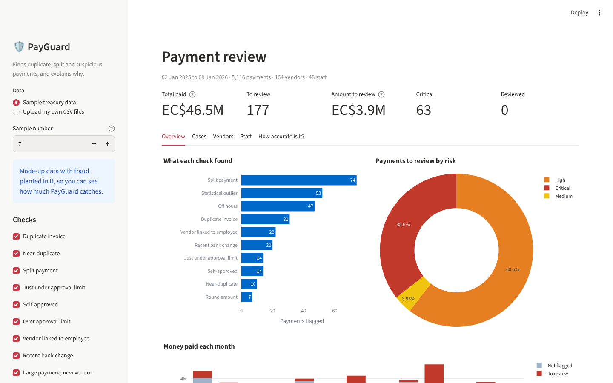
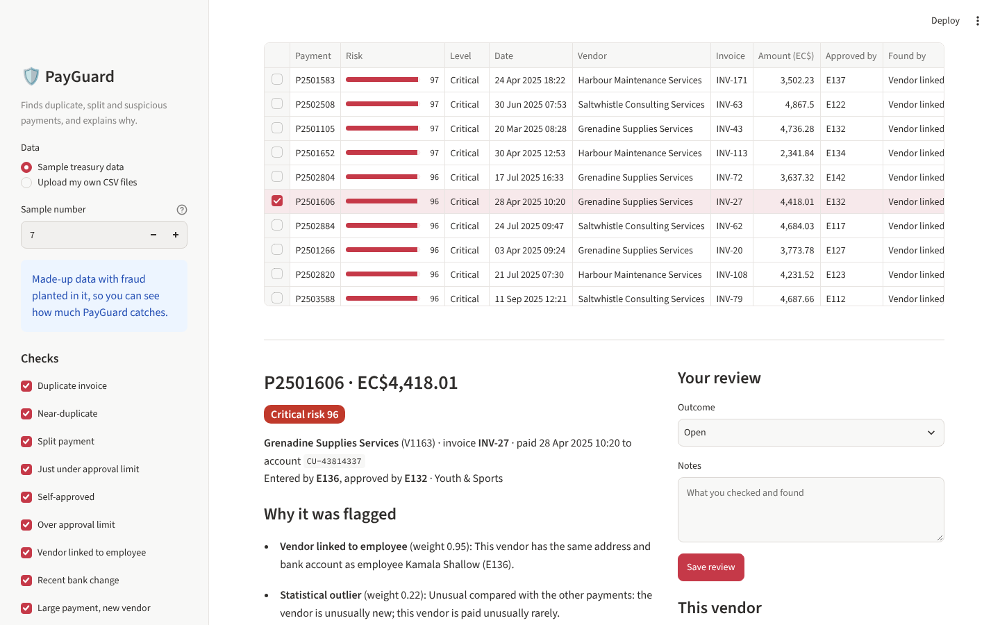

# PayGuard

**Finds duplicate, split and suspicious payments in accounts-payable data, and explains every flag in plain words.**

PayGuard reads a year of payments, the vendor list and the staff list, runs thirteen checks that internal auditors use, adds a machine-learning outlier model, and gives every payment a risk score from 0 to 100. Reviewers get a ranked list of cases, the reason for each one, and an Excel workbook and HTML report they can hand on.

It comes with a generator for realistic sample treasury data with fraud planted in it, so the detection rate can be measured instead of guessed.



## What it catches

| Check | What it looks for | Why it matters |
|---|---|---|
| **Duplicate invoice** | The same invoice number from the same vendor paid twice (ignoring dashes, spaces and case) | The most common payment error, and an easy way to steal |
| **Near-duplicate** | Same vendor and amount within 14 days, with an invoice number that is almost the same (`INV-4471` / `INV-4471A`, swapped digits) | Re-submitting an invoice with a changed number gets past exact checks |
| **Split payment** | Several payments to one vendor within 3 days, each under the approver's limit but over it together, and unlikely by chance for that vendor | Splitting a purchase avoids a senior approval |
| **Just under approval limit** | One approver repeatedly approving one vendor at 92–100% of their limit, far more often than chance (binomial test) | A common sign of a kickback arrangement |
| **Self-approved** | The same person entered and approved the payment | Breaks separation of duties |
| **Over approval limit** | Approved by someone whose limit is too low, or who isn't on the staff list | Control failure |
| **Vendor linked to employee** | A vendor shares a bank account, phone number or address (typos allowed) with a member of staff | The classic ghost-vendor fraud |
| **Recent bank change** | A payment soon after the vendor's bank account was changed, especially an unusually large one | Business email compromise: "please pay our new account" |
| **Large payment, new vendor** | A big payment to a vendor set up in the last 30 days | Fake vendors are paid quickly |
| **Invoice dated after payment** | The invoice date is after the money went out | Paperwork made to fit the payment |
| **Round amount** | Large round amounts unusual for that vendor | Weak alone; adds to other signals |
| **Off hours** | Entered on a weekend, a St. Vincent and the Grenadines public holiday, or outside office hours | Weak alone; adds to other signals |
| **Benford's law** | A vendor whose amounts don't follow Benford's first-digit distribution (Nigrini's MAD test) | Invented numbers often don't |
| **Statistical outlier** | Payments unlike the rest, found with an Isolation Forest on amount, vendor history, timing, invoice age and approval-limit use | Catches what no rule was written for |

Each check gives its findings a weight. A payment's risk score combines them as the chance that at least one is real: `100 × (1 − Π(1 − weight))`. Payments scoring 35 or more go to review: 80+ is critical, 60+ high, 35+ medium. Weak signals such as off-hours entry never put a payment in review on their own.

## How well it works

On a generated year of 5,116 treasury payments with 130 planted fraudulent ones (`payguard evaluate sample_data`):

| | |
|---|---|
| Planted fraud caught (recall) | **97%** (126 of 130) |
| Flagged payments that were planted fraud (precision) | **71%** (126 of 177) |
| F1 score | **0.82** |

| Type of fraud | Caught |
|---|---|
| Invoice paid twice | 22 / 22 |
| Invoice re-submitted with a changed number | 18 / 18 |
| Fake vendor set up by an employee | 22 / 22 |
| Entered and approved by the same person | 14 / 14 |
| Repeatedly approved just under a limit | 14 / 14 |
| Purchase split to dodge an approval limit | 31 / 34 |
| Bank account switched before a big payment | 5 / 6 |

Only 3.5% of all payments go to review. Most false alarms are legitimate payments that happen to look like a split purchase, which is the trade-off every split test makes. Across five different generated datasets, precision ranges from 60% to 71% and recall from 94% to 98% (averages 67% and 96%).

## Quick start

Requires Python 3.10 or newer.

```bash
git clone https://github.com/Jody2905/payguard.git
cd payguard
pip install -e ".[dashboard,dev]"

payguard generate --out sample_data          # a year of made-up payments with fraud planted in it
payguard scan sample_data --out reports      # Excel workbook + HTML report in reports/
payguard evaluate sample_data                # how much of the planted fraud was caught
streamlit run streamlit_app.py               # the dashboard, at http://localhost:8501
```

`payguard scan` prints the top cases:

```
Checked 5,116 payments (EC$46,453,471.68).
177 to review, worth EC$3,884,102.77: 63 critical, 107 high, 7 medium.

Top 5:
  P2501583  risk  96.7  EC$    3,502.23  Harbour Maintenance Services        Vendor linked to employee, Statistical outlier
  ...
```

Options: `--skip RULE ...` turns checks off, `--outliers 0.02` flags more statistical outliers (0 turns the model off).

## The dashboard

- **Overview:** what each check found, risk levels, money flagged each month, downloads of the Excel and HTML reports
- **Cases:** filter by risk, check or vendor; click a payment to see every reason, the related payments (the original of a duplicate, the other pieces of a split) and the vendor's payment history; record an outcome and notes, and download the review log
- **Vendors / Staff:** who has the most to review
- **How accurate is it?** (sample data) recall and precision as you turn checks on and off or move the threshold



## Using your own data

Put three CSV files in a folder: `payments.csv`, `vendors.csv` and `employees.csv`.

| File | Columns |
|---|---|
| payments | `payment_id`, `payment_date`, `vendor_id`, `invoice_no`, `invoice_date`, `amount`, `bank_account`, `created_by`, `approved_by`, `department`, `description` |
| vendors | `vendor_id`, `name`, `address`, `phone`, `bank_account`, `created_date`, `created_by`, `bank_changed_date` |
| employees | `employee_id`, `name`, `address`, `phone`, `bank_account`, `department`, `approval_limit` |

`invoice_date`, `department`, `description`, `bank_changed_date` and the vendor's `created_by` may be left out. PayGuard checks the files first and says exactly what is missing or unreadable. Thresholds live in `Settings` in `payguard/rules.py`.

Real payment data is confidential: run PayGuard on your own machine or a private deployment, and never commit real data to a public repository.

## Project layout

```
payguard/
  data.py        loading and validating the three tables
  rules.py       the thirteen checks, each with a plain-words explanation
  anomaly.py     Isolation Forest outlier model with reasons
  scoring.py     risk score, cases, summaries by vendor and staff
  report.py      Excel workbook and single-file HTML report
  generate.py    realistic sample data with planted fraud (truth.csv)
  evaluate.py    recall / precision against the planted fraud
  holidays.py    St. Vincent and the Grenadines public holidays
  cli.py         payguard generate | scan | evaluate
streamlit_app.py the dashboard
tests/           pytest suite (rules on hand-made cases + the full pipeline)
```

## Tests

```bash
pytest
```

The suite checks each rule on small hand-made cases, including the things it must not flag (monthly contracts, a neighbour's address, a single payment over the limit), plus the full pipeline on generated data: at least 90% recall, at least 50% precision, and every flag explained. GitHub Actions runs it on every push.

## Built with

Python · pandas · NumPy · scikit-learn · RapidFuzz · openpyxl · Streamlit · Plotly · pytest

## Note

A flag is a reason to look, not proof of fraud. All names, vendors, accounts and phone numbers in the sample data are invented.

## License

MIT
